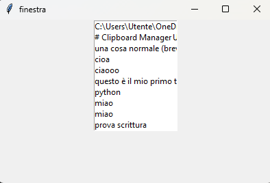

# Clipboard Manager

Un piccolo clipboard manager per Windows scritto in Python: tiene uno storico degli ultimi elementi copiati negli appunti e permette di richiamarli in qualsiasi momento con una combinazione di tasti globale.



## Funzionalità

- Monitora la clipboard di sistema e salva automaticamente ogni nuovo elemento copiato
- Evita i duplicati: ricopiare qualcosa già presente nello storico lo sposta in cima invece di duplicarlo
- Limita lo storico a un numero massimo di elementi (configurabile)
- Hotkey globale (**Ctrl+Alt+V**) che apre una finestra con l'elenco degli elementi copiati
- Doppio click su un elemento per ricopiarlo negli appunti
- Storico persistente: sopravvive alla chiusura e riapertura del programma (salvato in `clipboard_history.json`)
- Gestione degli errori su input non validi, file corrotti/mancanti e contenuti non testuali (es. immagini)
- Avviabile in automatico all'accensione del PC, senza finestra di terminale visibile

## Come funziona

- Un ciclo in background controlla il contenuto della clipboard a intervalli regolari (`pyperclip`)
- La hotkey globale viene gestita da un listener dedicato (`pynput`), su un thread separato
- Siccome l'interfaccia grafica (`tkinter`) deve girare sul thread principale, la comunicazione tra il listener della hotkey e la finestra passa da una coda thread-safe (`queue.Queue`)
- Lo storico viene salvato in formato JSON ad ogni modifica

## Installazione (da sorgente)

```bash
git clone <url-del-repository>
cd clipboard-manager
python -m venv venv
venv\Scripts\Activate.ps1
pip install -r requirements.txt
python main.py
```

## Creare un eseguibile standalone (Windows)

Con il virtual environment attivo:

```bash
pip install pyinstaller
pyinstaller --onefile --noconsole main.py
```

L'eseguibile verrà creato in `dist/main.exe` — non richiede Python installato per funzionare.

## Avvio automatico (Windows)

Per farlo partire automaticamente al login, crea un collegamento a `main.exe` nella cartella di avvio di Windows (raggiungibile scrivendo `shell:startup` nella barra degli indirizzi di Esplora File), impostando come "Percorso di partenza" la cartella in cui si trova l'eseguibile.

## Limitazioni note

- Gestisce solo contenuti testuali — copiare un'immagine viene semplicemente ignorato (non supportato, vedi "Sviluppi futuri")
- L'eseguibile standalone è specifico per Windows: PyInstaller non fa cross-compilazione, servirebbe ricostruirlo separatamente su macOS/Linux
- I testi più lunghi di una soglia configurabile vengono ignorati per evitare rallentamenti nel salvataggio su disco
- Non è pensato per sostituire la cronologia appunti nativa di Windows (Win+V), che supporta anche le immagini — è nato come progetto di apprendimento

## Sviluppi futuri

- Supporto per le immagini (richiederebbe `Pillow` e un modello dati diverso)
- Build multipiattaforma (macOS/Linux)

## Cosa ho imparato

Questo è il mio primo progetto in Python — puramente a scopo formativo, l'ho usato per imparare il linguaggio da zero, toccando con mano thread, GUI, persistenza su file e packaging in un eseguibile standalone.
